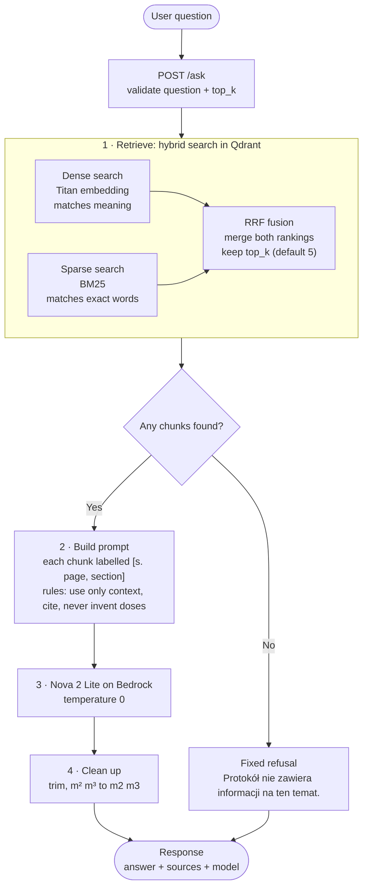
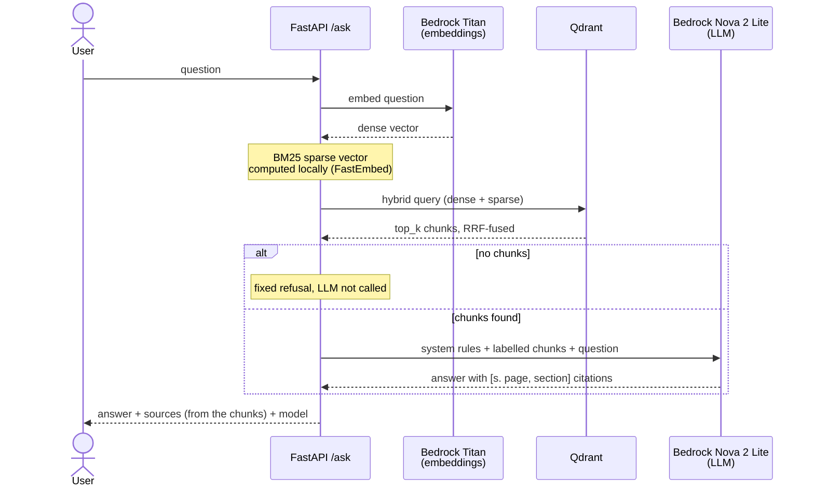

# Ask flow

How `POST /ask` turns a question into a cited answer. One pass, no loops: retrieve, prompt, generate.
Code: `app/api.py` (endpoint), `app/chain.py` (chain), `app/store.py` (hybrid store).

## Steps

## Who talks to whom

## Worth knowing

- **Why two searches:** dense finds paraphrases, BM25 finds exact terms (drug names, section codes, units).
  RRF merges the two rankings by position. Hybrid won the retrieval experiments, see
  `requirements/01-rag-mvp.md`.
- **Refusals mostly come from the model.** The "no chunks" branch only fires on an empty collection; otherwise the
  prompt tells the model to answer with the exact refusal phrase when the context does not cover the question.
- **Two kinds of citations.** `[s. page, section]` inside `answer` is copied by the model from the chunk labels.
  `sources` is built from the retrieved chunks, never parsed from the model output.
- **Ingest is separate.** `app/ingest.py` parses the PDF with Docling and fills Qdrant; it is not part of this flow.
